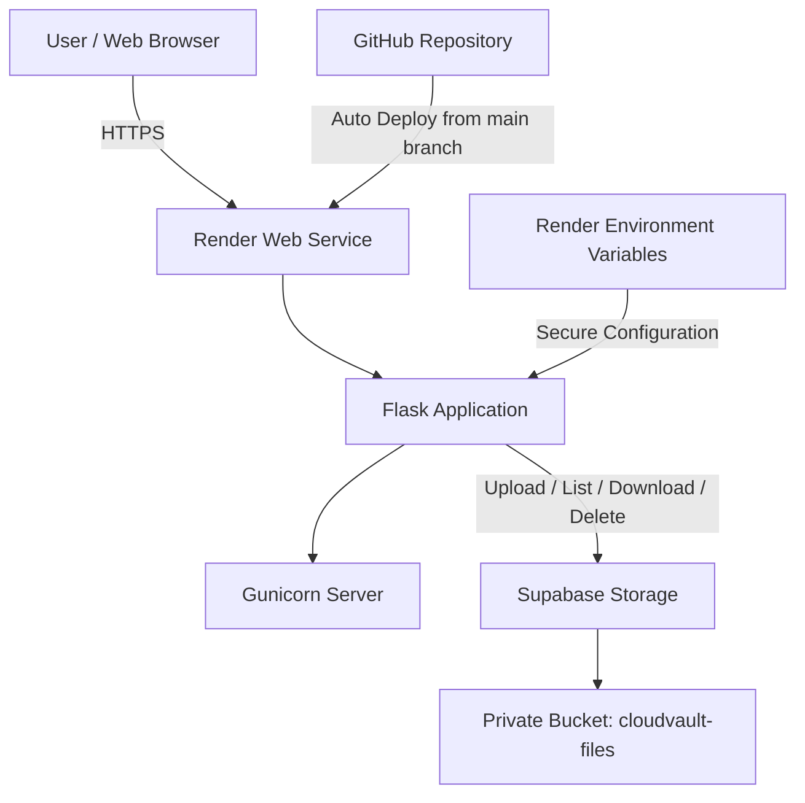

# CloudVault – Cloud Architecture

## Architecture Overview

CloudVault is a cloud-based file storage and document management system built using Flask, Render, and Supabase Storage.

## Architecture Diagram

## Components

1. **User Interface:** HTML, CSS, and JavaScript provide the file management dashboard.
2. **Application Backend:** Python Flask handles login, uploads, file listing, downloads, and deletion.
3. **Application Hosting:** Render hosts the Flask application using Gunicorn.
4. **Cloud Object Storage:** Supabase Storage stores uploaded files in a private bucket.
5. **Source Code Management:** GitHub stores the project source code and triggers automatic deployments.
6. **Environment Configuration:** Render environment variables securely hold application credentials and configuration.

## File Workflow

1. The user logs in to CloudVault.
2. The user selects a file through the dashboard.
3. Flask validates the file type and size.
4. The backend uploads the file to the private Supabase Storage bucket.
5. The dashboard retrieves and displays the stored file list.
6. The user can download or delete files.

## Security

- Session-based login protection.
- Maximum upload size of 10 MB.
- File type validation.
- Private Supabase Storage bucket.
- Secret credentials stored in environment variables.
- HTTPS through Render.

## Technologies Used

- Python
- Flask
- HTML, CSS, JavaScript
- Supabase Storage
- Render
- Gunicorn
- GitHub
